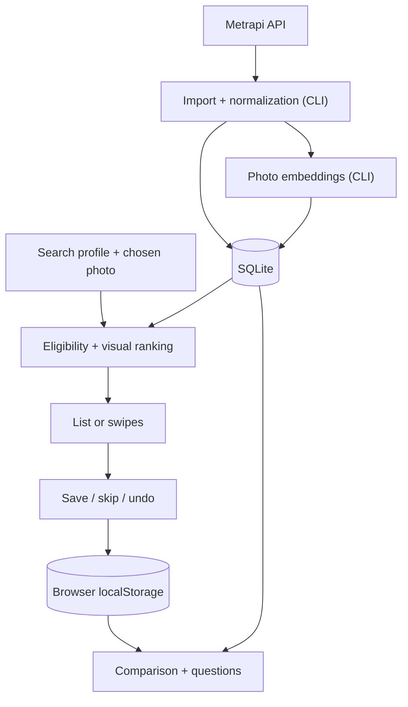

## Current implementation — 14 November 2026

House passports, explicit weekly transit calculations, public browser-session isolation
and the PR38 interface are implemented on feature/bereg-complete. The historical
proposal paragraphs below record the prior baseline; current runtime and limitations
are in README and implementation-status.md. Flask/Jinja/SQLite remain the stack.

# Architecture

## Implemented baseline

| Feature | What is built |
| --- | --- |
| Search by conditions | Catalog with limits on monthly cost, move-in cost, rooms, districts, pets requirement |
| Clear flat card | Photos, main parameters, terms of each offer, known costs, unknown terms, source link |
| Similar interior search | User picks a photo; app re-orders already-eligible flats by visual similarity |
| Favorites and comparison | Save flats, compare up to 5 by the same fields, questions for missing data |
| Swipe mode | Save / skip / details / undo over the same list, filters and favorites |

## Previously proposed house integration (historical)

The earlier v1 exclusion of house passports is superseded by the user's decision to use collected house evidence for rental decisions. [Product brief](product-brief.md), [house proposal](house-passport/README.md), and [dataset](../research/house-passports/README.md) describe the intended integration. House ingestion, storage and routes are not implemented on this baseline. The [open draft PR 38](https://github.com/Sacraer-group/farposton/pull/38) proposes UI changes; it is not merged. Separately, manual house-source collection may be considered subject to source access rules; listing ingestion remains through the official Metrapi API and existing security, privacy and money constraints remain in force.

## Product direction and data boundary

The decision journey is requirements and priority → three candidates → source-backed house check and comparison → viewing brief and questions. The goal is to understand cash, house evidence and route uncertainty before visiting. Swipe is secondary. See [decision-flow.md](decision-flow.md).

The redesign exposes this hierarchy using the existing offer data. The source snapshot has addresses, coordinates and floors; it does not supply building year, material, managing company, outages or repairs. Missing house information must be shown as unavailable, not inferred. Offer eligibility is separate from verification of the house address. Additional locally curated house records may have their own source and date; they are snapshots, not live provider data. Missing records remain unknown.

## Out of scope

Fair price prediction; own parsers; own duplicate model; unrestricted AI chat and long reports; owner/fraud/defect checks; notifications, accounts, shared choice, mobile app; scheduler, Redis, vector DB, SPA, model server; uploading external reference photos; learning from swipes.

## Advisor direction

A bounded advisor is now in scope. It reuses eligibility and offer costs, retrieves at most five actual candidates lexically, and can call an optional OpenAI-compatible chat/completions provider. The model selects supplied candidate, fact and question IDs; server-side rendering rejects unknown and cross-offer IDs. Without a configured provider the response is explicitly retrieval-based. No new schema, packages or vector database are required. Implementation and verification are tracked in [state.md](state.md).

## Data flow

Two modes:

1. **Prepare data** (manual CLI commands): `flats import`, `flats embed`.
2. **Use the app** (Flask server): filter ready data, view, save, compare.

## Modules and file ownership

Package name: `flats` (directory `flats/`). Each module has one owner task per sprint.

| Module | File | Job |
| --- | --- | --- |
| Config | `flats/config.py` | Read env vars (`METRAPI_KEY`, `FLATS_DB`, `FLATS_PHOTO_DIR`) |
| DB | `flats/db.py`, `flats/schema.sql` | Connect, create schema |
| Source loader | `flats/metrapi.py`, `scripts/fetch_metrapi.py` | One official API call; Metrapi item -> normalized offer dict |
| Money parsing | `flats/money.py` | Parse deposit/commission/prepayment strings into typed terms |
| Costs | `flats/costs.py` | Monthly and move-in cost of one offer |
| Eligibility | `flats/eligibility.py` | `match` / `unknown` / `reject` per offer and profile |
| Questions | `flats/questions.py` | Rule-based questions from missing or conflicting data |
| Import | `flats/importer.py` | Fetch, validate, upsert offers, record import run |
| Repositories | `flats/repo_offers.py`, `flats/repo_user.py` | SQL reads/writes |
| Grouping | `flats/grouping.py` | Offers -> flat cards by `group_id` |
| Search service | `flats/search.py` | Profile -> ordered list of flat cards with reasons |
| Embeddings | `flats/embed.py` | Download photos, compute vectors |
| Similarity | `flats/similar.py` | Cosine similarity with NumPy |
| CLI | `flats/cli.py` | `init-db`, `import-json`, `demo`, `embed` |
| Web | `flats/web/*.py`, `flats/templates/*`, `flats/static/*` | Pages and JSON actions |

## Stack

Python 3.11+, Flask (Jinja), `sqlite3` from stdlib, `requests`, NumPy; Transformers + PyTorch + Pillow only for sprint 4. Plain HTML/CSS/JS. The map uses locally served Leaflet assets and OpenStreetMap tiles; tiles require a network connection and OpenStreetMap attribution. `pytest` for tests.

## Key rules

- Costs are computed from **one offer**, never mixed across offers of one flat.
- Unknown is not zero. Unknown pets is not "allowed".
- Raw string is stored next to the parsed value.
- Totals are computed on read, not stored.
- Web decisions reference the offer (`source`, `source_id`), not the group. Save/skip history is kept in `localStorage` key `farposton.decisions.v1`; legacy SQLite decisions remain intact and are not imported. Storage events and `pageshow` refresh views.
- Favorites reveals browser-local saves among hidden public offer candidates and disables hidden comparison checkboxes. Comparison accepts up to five explicitly requested existing offer IDs without adding them to local storage.
- Advisor and `/api/trips/start` requests carry compact local decisions validated by `repo_user.validate_browser_decisions`, without persistence or database fallback. Advisor saved scope uses the whole saved set; explicit chosen IDs retain the five-item limit. Trip jobs exclude skipped groups and skipped sibling offers before spending API budget. House related lists also apply local decisions. Filters and sample photo continue to use visitor sessions in PUBLIC_DEMO and the existing single-user behavior in local mode.
- Visual search never brings back a `reject` flat.
- Failed import keeps the previous working data.
- A listing missing from a new import is not marked "rented".

