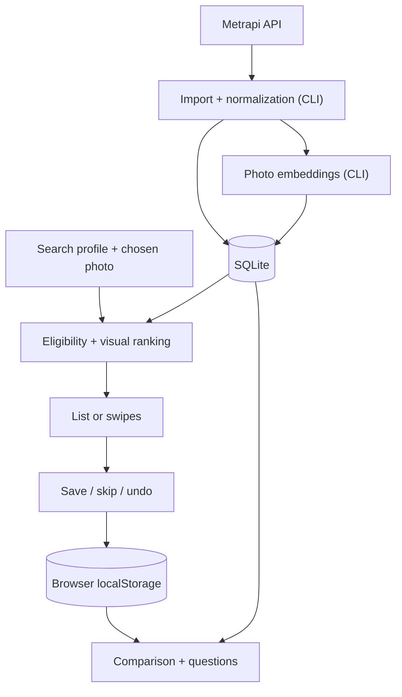

# Architecture

## Scope (v1)

| Feature | What is built |
| --- | --- |
| Search by conditions | Catalog with limits on monthly cost, move-in cost, rooms, districts, pets requirement |
| Clear flat card | Photos, main parameters, terms of each offer, known costs, unknown terms, source link |
| Similar interior search | User picks a photo; app re-orders already-eligible flats by visual similarity |
| Favorites and comparison | Save flats, compare up to 5 by the same fields, questions for missing data |
| Swipe mode | Save / skip / details / undo over the same list, filters and favorites |

## Accepted next slice (proposed)

The earlier v1 exclusion of house passports is superseded by the user's decision to use collected house evidence for rental decisions. [Product brief](product-brief.md), [house proposal](house-passport/README.md), and [dataset](../research/house-passports/README.md) describe the intended integration. House ingestion, storage and routes are not implemented on this baseline. The [open draft PR 38](https://github.com/Sacraer-group/farposton/pull/38) proposes UI changes; it is not merged. Separately, manual house-source collection may be considered subject to source access rules; listing ingestion remains through the official Metrapi API and existing security, privacy and money constraints remain in force.

## Out of scope (v1, historical)

House passport (management company, outages, complaints); route calculation; fair price prediction; own parsers; own duplicate model; AI chat and long reports; owner/fraud/defect checks; notifications, accounts, shared choice, mobile app; scheduler, Redis, vector DB, SPA, model server; uploading external reference photos; learning from swipes.

## Data flow

Two modes:

1. **Prepare data** (manual CLI commands): `flats import`, `flats embed`.
2. **Use the app** (Flask server): filter ready data, view, save, compare.

## Modules and file ownership

Package name: `flats` (directory `flats/`). Each module has one owner task per sprint.

| Module | File | Job |
| --- | --- | --- |
| Config | `flats/config.py` | Read env vars (`METRAPI_KEY`, `FLATS_DB`, `FLATS_PHOTO_DIR`) |
| DB | `flats/db.py`, `flats/schema.sql` | Connect, create schema |
| Source loader | `flats/metrapi.py`, `scripts/fetch_metrapi.py` | One official API call; Metrapi item -> normalized offer dict |
| Money parsing | `flats/money.py` | Parse deposit/commission/prepayment strings into typed terms |
| Costs | `flats/costs.py` | Monthly and move-in cost of one offer |
| Eligibility | `flats/eligibility.py` | `match` / `unknown` / `reject` per offer and profile |
| Questions | `flats/questions.py` | Rule-based questions from missing or conflicting data |
| Import | `flats/importer.py` | Fetch, validate, upsert offers, record import run |
| Repositories | `flats/repo_offers.py`, `flats/repo_user.py` | SQL reads/writes |
| Grouping | `flats/grouping.py` | Offers -> flat cards by `group_id` |
| Search service | `flats/search.py` | Profile -> ordered list of flat cards with reasons |
| Embeddings | `flats/embed.py` | Download photos, compute vectors |
| Similarity | `flats/similar.py` | Cosine similarity with NumPy |
| CLI | `flats/cli.py` | `init-db`, `import-json`, `demo`, `embed` |
| Web | `flats/web/*.py`, `flats/templates/*`, `flats/static/*` | Pages and JSON actions |

## Stack

Python 3.11+, Flask (Jinja), `sqlite3` from stdlib, `requests`, NumPy; Transformers + PyTorch + Pillow only for sprint 4. Plain HTML/CSS/JS. `pytest` for tests.

## Key rules

- Costs are computed from **one offer**, never mixed across offers of one flat.
- Unknown is not zero. Unknown pets is not "allowed".
- Raw string is stored next to the parsed value.
- Totals are computed on read, not stored.
- Web decisions reference the offer (`source`, `source_id`), not the group. The browser keeps save/skip history in `localStorage` under `farposton.decisions.v1`; undo removes a decision from that journal. Legacy SQLite decisions remain intact and are not imported. Storage events and `pageshow` refresh the browser view.
- Favorites renders public offer candidates hidden until the browser reveals its saves; hidden comparison checkboxes are disabled. Comparison accepts up to five explicitly requested existing offer IDs and does not add them to local storage.
- Search profile and sample photo remain shared in SQLite; browser-local decisions do not isolate them.
- Visual search never brings back a `reject` flat.
- Failed import keeps the previous working data.
- A listing missing from a new import is not marked "rented".

