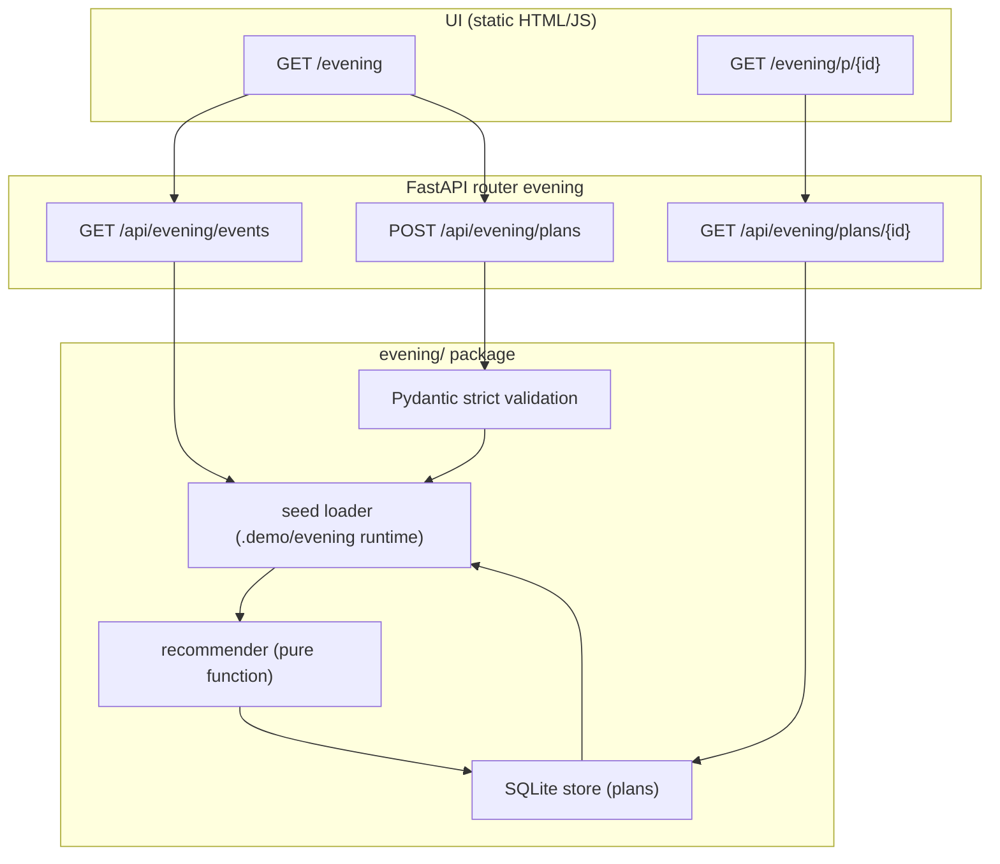

# «Готовый вечер» — архитектура MVP

## Обзор



## Модули

| Модуль | Ответственность |
|---|---|
| `evening/__init__.py` | Пакет MVP |
| `evening/seed.py` | Загрузка/генерация runtime fictionalseed (25 мест, 6 событий) в `.demo/evening/`; не перезаписывает существующий; даты ближайшие; только этот источник по умолчанию |
| `evening/models.py` | Pydantic-модели запроса/ответа, строгая валидация (UUID, bool/int, enum, max 5, уникальность, пересечение, лишние поля) |
| `evening/recommender.py` | Чистая функция подбора primary/alternative без LLM/2ГИС/Forecast |
| `evening/store.py` | SQLite `plans`: параметризованный SQL, expiry 24h, read current revalidate, без raw текста/контактов |
| `evening/routes.py` | FastAPI router с зависимостью `require_auth`, страницы и API, обработка ошибок |
| `evening/timeutil.py` | Работа с `Asia/Vladivostok`, интервалы `[start,end)`, проверка окна еды |

## Данные

### Seed (runtime, `.demo/evening/seed.json`)
- `places` (25): `id`, `name`, `category`, `distance_m` (от условной точки/событий), `hours` (расписание по дням), `features` (`{dog,laptop,children,terrace,reservations}` со значениями `true|false|unknown`), `synthetic: true`.
- `events` (6): `id` (UUID), `title`, `starts_at` (ISO +10:00), `date` (local), `status` (`scheduled|cancelled|rescheduled|past`), `synthetic: true`.
- Генерация: если файл отсутствует — создать с датами относительно текущего дня запуска (Asia/Vladivostok); если есть — читать без перезаписи.

### SQLite (`.demo/evening/plans.sqlite3` или путь из env/volume)
Таблица `plans`:
- `id TEXT PRIMARY KEY` (uuid4)
- `snapshot_json TEXT NOT NULL` (снимок без `current`)
- `created_at TEXT NOT NULL`
- `expires_at TEXT NOT NULL`

Соединение на запрос, параметризованный SQL. TTL 24 часа проверяется при чтении (`410`).

## Логика рекомендаций

```mermaid
flowchart TD
  In[Запрос] --> V[Строгая валидация]
  V --> Ev[Найти событие в seed]
  Ev --> Ok{scheduled и не прошло?}
  Ok -- нет --> C409[409 event_unavailable]
  Ok -- да --> F[Фильтр мест]
  F --> F1[открыто на всём meal interval)
  F1 --> F2[distance_m <= max_distance_m]
  F2 --> F3[все required_features == true]
  F3 --> N{>=2 места?}
  N -- нет --> N409[409 not_enough_places]
  N -- да --> S[Сортировка: pref desc, distance asc, id asc]
  S --> P1[primary = первое]
  S --> B[alternative: другая category если есть, иначе следующее]
  B --> Save[Сохранить snapshot, TTL 24h]
```

`unknown` признак не засчитывается как подтверждённый required и показывается отдельно в `unknown`.

## Чтение плана и `current`

- `GET /api/evening/plans/{id}`: загрузить snapshot, проверить expiry (`410`), пересчитать `current` по актуальному seed (revalidate), вернуть snapshot + current + sources/checked_at.
- `current.event_status`: `cancelled/rescheduled/past` если событие в seed с таким статусом; `unavailable` если событие отсутствует/удалено; `stale` при ошибке чтения/проверки источника; иначе `scheduled`.
- Снимок не изменяется.

## Интеграция

- Минимальная интеграция в `web/app.py`: импорт и `include_router` evening router, маршруты страниц `/evening`, `/evening/p/{id}` (через router или app — по существующему паттерну с auth).
- Отдельный lightweight entrypoint для Docker (`evening_app.py` или аналог) может создавать FastAPI app, подключать тот же router и переиспользовать существующие зависимости/auth/helpers из `web` без нового списка версий.

## Docker

- `Dockerfile.evening`: allowlist COPY (нужные `web/`, `evening/`, `src/` если требуется для auth/paths, статика, docs не обязательны), без ключей/2GIS/.git/.venv/.opencode/.demo хоста.
- `compose.evening.yaml`: `127.0.0.1:18447`, nonroot, volume для `.demo/evening`/состояния SQLite, healthcheck на `/api/evening/events` (с учётом auth/demo режима для контейнера).
- `DOCKER-EVENING.md`: команды build/run/проверки.
- Образ clean clone: runtime seed создаётся внутри контейнера при первом старте в volume/рабочей области, без внешних данных.

## Тесты

- F1–F8 и дополнительные: timezone, SQL injection safety (параметризация), TTL, отмена/недоступность при чтении, полное покрытие окна `[start,end)`, план Б.
- Запуск: `/home/recara/farposton/.venv/bin/python` с `PYTHONPATH` нового worktree; `make test VENV=...` после `demo.local prepare` в новом worktree при необходимости.
