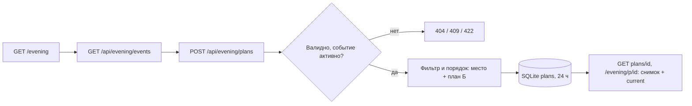

# «Готовый вечер»: спецификация MVP

Из сводки взяты маршруты, стек и запреты. Числовые границы, enum признаков, коды ошибок и имена файлов — мои допущения. Весь seed — синтетика.



## Компоненты
- **Роутер `evening`** в текущем FastAPI, страницы на HTML+JS.
- **Seed** `evening_seed.json`: 25 мест и 6 событий с `

---

# «Готовый вечер»: спецификация MVP

Маршруты, стек и запреты взяты из проверенной сводки. Числовые границы, enum, имена полей и файлов — мои допущения. Весь seed — синтетика. Файлы я не читал.


## Компоненты
- **Роутер `evening`** живёт в текущем FastAPI и отдаёт две HTML/JS-страницы.
- **`evening_seed.json`** содержит 25 вымышленных мест и 6 событий; даты заданы смещением от дня запуска, файл только для чтения, в UI стоит пометка «вымышлено».
- **SQLite `plans(id, snapshot, created_at, expires_at)`**: соединение на запрос, параметризованный SQL, без имён, телефонов и raw AI.
- **Рекомендатор** — чистая функция без LLM, 2ГИС и Forecast.

## Вход `POST /api/evening/plans`
```json
{
  "event_id": "string, 1–64",
  "date": "YYYY-MM-DD, равна дате события (Asia/Vladivostok)",
  "meal_start": "HH:MM",
  "meal_end": "HH:MM, позже meal_start, не позже начала события",
  "required_features": ["enum, 0–5, уникальные"],
  "preferred_features": ["enum, 0–5, без пересечения с required"],
  "max_distance_m": "integer, 100–5000"
}
```
Лишние поля дают 422.

## Выход (201 и `GET plans/{id}`)
```json
{
  "id": "uuid4", "created_at": "ISO +10:00", "expires_at": "created_at + 24 ч",
  "synthetic": true,
  "event": {"id": "", "title": "", "starts_at": "", "status": "scheduled"},
  "primary": {"place_id": "", "name": "", "distance_m": 420,
    "confirmed": [], "unknown": [], "matched_preferred": []},
  "alternative": "та же форма, что primary",
  "current": {"event_status": "scheduled|cancelled|rescheduled|past", "starts_at": "", "stale": false}
}
```
`current` считается при чтении и не сохраняется. `distance_m` — расстояние по прямой; минут пути в ответе нет.

## Ошибки
| Код | Когда |
|---|---|
| 404 | нет такого события или плана |
| 422 | формат, границы, дата не совпадает с событием, окно еды не до события |
| 409 | `event_unavailable` (отменено или прошло) или `not_enough_places` (меньше двух мест), с понятным текстом |
| 410 | план старше 24 ч |

## Правила
- **Часы работы:** место должно быть открыто на всём интервале `[meal_start, meal_end]`.
- **Обязательные признаки:** подходит только значение `true` в seed; `unknown` выводится отдельно и подходящим не считается.
- **Порядок:** сначала больше совпавших пожеланий, затем меньше расстояние, затем id.
- **План Б:** следующее место другой категории, а если такого нет — следующее по порядку; обязательные признаки и расстояние те же.
- **Столы:** в UI стоит текст «наличие столов не проверено»; бронь, загруженность 2ГИС и Forecast наличием стола не считаются.
- **2ГИС:** в MVP не вызывается; доступ к полям, условия хранения и прогноз проверяются отдельно до подключения.

## Docker
`Dockerfile.evening` и `compose.evening.yaml`, порт `127.0.0.1:18447`, nonroot, healthcheck на `/api/evening/events`. Volume нужен только для SQLite; seed лежит в image, секретов и выгрузок 2ГИС там нет.

## Приёмочные тесты
| ID | Требование | Проверка |
|---|---|---|
| F1 | События | GET возвращает seed-события; POST на отменённое или прошедшее даёт 409 |
| F2 | Валидация | неверные типы, границы и лишние поля дают 422; неизвестный `event_id` — 404 |
| F3 | Еда до события | `meal_end` позже начала

---

| F3 | Еда до события | `meal_end` позже начала события или не позже `meal_start` даёт 422 |
| F4 | Часы работы | Место, закрытое в любой части окна еды, не попадает в выдачу |
| F5 | Обязательные признаки | В выдаче только места с подтверждёнными признаками; `unknown` показан отдельно и не засчитан |
| F6 | План Б | `alternative` проходит те же ограничения; если мест меньше двух, приходит 409 `not_enough_places` |
| F7 | Сохранённый план | `current` считается при чтении, снимок не меняется; после 24 ч приходит 410 |
| F8 | Docker из чистого clone | Порт `127.0.0.1:18447`, nonroot, healthcheck проходит; в image только вымышленный seed, без секретов и данных 2ГИС |

## Документы к созданию

Имена — мои допущения.

1. `docs/evening-spec.md` — маршруты, контракт входа и выхода, коды ошибок, правила выдачи.
2. `docs/evening-data.md` — происхождение каждого поля (синтетика, подтверждено или гипотеза), что не хранится, и условия 2ГИС, которые нужно подтвердить до любого использования.
3. `docs/evening-tests.md` — матрица F1–F8 с именами тестов.

## Traceability

Каждому функциональному ID F1–F8 соответствует хотя бы один автотест с этим ID в имени. ID без теста или тест без ID блокирует приёмку.

Не проверено: файлы не читались, поэтому имена, границы и enum — допущения; их нужно сверить с репозиторием и с `docs/constraints.md`, если он есть. Риск: весь seed вымышлен, поэтому MVP ничего не говорит о реальных местах, свободных столах и посещаемости.