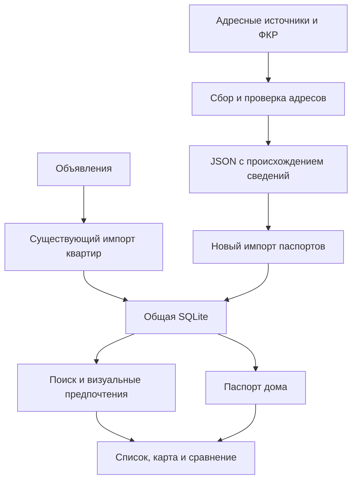

# Новая архитектура Farposton: квартира и паспорт её дома

## Решаемая задача

Помочь человеку выбрать квартиру для долгосрочной аренды во Владивостоке, сопоставив **условия квартиры** с **известными сведениями о доме**. Пользователь открывает объявление, проверяет дом и сравнивает 3–5 вариантов с пониманием того, что известно и что требуется уточнить на просмотре.

Паспорт дома входит в основную версию. Карта, список и сравнение используют одни данные. Свайпы и визуальные предпочтения сохраняют свою вспомогательную роль в отборе квартир.

## Основа решения

Существующий проект использует Flask, Jinja и SQLite. Для этого объёма сохраняем один сервер и одну БД. Сбор внешних данных выполняется отдельным явным запуском; открытие паспорта читает локальную БД. Новые постоянные фоновые сервисы, очереди и отдельное клиентское приложение для этой задачи не нужны.

Схема описывает целевое поведение. Новый импорт и экраны пока являются задачами следующего этапа.

## Блоки, входы и выходы

| Блок | Вход | Выход и ответственность |
|---|---|---|
| Существующий каталог | Предложения с ключом `(source, source_id)` | Квартиры, условия, поиск, сохранённые варианты, решения пользователя, визуальные признаки. |
| Сопоставление адреса | Город, улица, номер, литера, корпус, строение; опубликованный адрес источника | Отдельный локальный `house_id` и объяснимый статус привязки. Неуверенное совпадение не становится точным. |
| Сбор сведений | 48 адресов и открытые адресные источники | Структурированный снимок с исходными полями, ссылками, датами, покрытием и ошибками. Уже выполнен для данного набора. |
| Импорт паспортов | `house_passports.json`, `schema_version = 1` | Дома, связи с существующими предложениями, наблюдения источников, факты, контакты и события. Повтор того же снимка не создаёт дубли. |
| Чтение паспорта | `house_id` либо ключ предложения | Согласованная структура паспорта с доступными фактами, конфликтами и пробелами. |
| Карта | Тот же результат поиска, который виден в списке | Один маркер на дом и отдельные ссылки на подходящие квартиры в нём. |
| Сравнение | Выбранные 3–5 предложений | Условия каждой квартиры плюс краткие сведения о её доме и ссылка на паспорт. |

## Ключевое разделение: предложение, квартира, дом

`(source, source_id)` — конкретное объявление. `group_id` / `FlatCard.key` — существующая группировка объявлений одной квартиры. `house_id` — новый отдельный идентификатор здания.

В текущей выборке по Окатовой, 14 и Окатовой, 18 есть по две разные квартиры. На карте это по одному дому с двумя вариантами. В сравнении квартиры остаются отдельными столбцами со своими ценой, залогом и комиссией. Паспорт дома общий.

Номера `12/1`, `12 корпус 1` и `12` нельзя объединять без подтверждения. Ключи B001–B048 относятся только к текущему файлу сбора и не становятся постоянными ID БД. Числовой ID VL.ru хранится как идентификатор внешнего источника.

## Хранение

Предлагается добавить шесть таблиц к существующей схеме:

| Таблица | Что хранит |
|---|---|
| `houses` | Разобранный точный адрес и локальный идентификатор. |
| `offer_houses` | Связь объявления с домом, основание, статус и проверенную версию адреса. |
| `house_sources` | Наблюдение или попытку получения сведений: источник, время, состояние, покрытие, исходный JSON. |
| `house_facts` | Фиксированный набор характеристик и координаты с привязкой к наблюдению источника. |
| `house_contacts` | Опубликованную организацию, роль, контакты и статус её связи с домом. |
| `house_events` | Публикации об отключениях, планируемых работах и сообщениях об исполнении. |

Новая ошибка источника сохраняется отдельно от последнего успешного результата. Конфликт двух опубликованных УК сохраняет обе версии. Неизвестная сумма, дата или характеристика остаётся неизвестной. Число архивных публикаций не используется как рейтинг надёжности дома.

## Задания, выданные субагентам

| Исполнитель | Что уже подготовил | Зона реализации следующего этапа |
|---|---|---|
| `collect_house_management` | Доменные контракты, модель адреса, добавочную SQL-схему, проверку совместимости | Схема, точное сопоставление, слой хранения и функции чтения паспорта. Подробности в `01-domain-storage.md`. |
| `collect_house_repairs` | Контракт загрузки текущего JSON, правила происхождения и повторного импорта | Импорт снимка, обработка ошибок и неполного покрытия, отдельный сбор обновлений. Подробности в `02-ingestion-provenance.md`. |
| `collect_house_outages` | Маршруты, экран паспорта, карту и интеграцию в сравнение | Серверные страницы, безопасное отображение, карта с общими фильтрами и ссылки из карточек. Подробности в `03-web-map-comparison.md`. |

В каждом специализированном документе есть конкретные задачи с файлами во владении исполнителя, зависимостями, контрактами и критериями приёмки. Это выполненная работа по проектированию; она не означает, что интерфейс уже появился на сайте.

## Порядок реализации

1. **Хранилище и контракты.** Добавить схему и точную адресную привязку; реализовать согласованные функции репозитория. Проверить сохранность существующих данных.
2. **Импорт текущего снимка.** Загрузить все 48 домов и связать 50 предложений. Проверить повторный импорт, неизвестные адреса, конфликты и сохранение последнего успешного наблюдения после ошибки.
3. **Паспорт и интеграция.** Реализовать паспорт и общий блок сведений; после общих интерфейсов карта и строки сравнения могут разрабатываться параллельно.
4. **Приёмка на реальных краевых случаях.** Два предложения на дом; три конфликта УК; два адреса без найденной УК; пустая история источника; несовпадения этажности и корпуса. Затем проверить существующие поиск, решения пользователя, сравнение и визуальную функцию.

Один интегратор обновляет существующие `docs/contracts.md`, `docs/architecture.md`, `docs/constraints.md` и состояние проекта. Ранее записанное исключение паспортов домов из области проекта заменяется новой явно заданной пользователем целью. Параллельные исполнители не редактируют одни и те же общие файлы.

## Что входит в первую полезную версию

Паспорт показывает точный адрес, доступные характеристики, опубликованную УК и службы, историю сообщений об отключениях, планы капремонта и отчётные сведения об исполнении. У каждого раздела видны источник, дата и пробелы. Из обнаруженных пробелов можно собрать короткие вопросы на просмотр обычными правилами, без запроса к языковой модели.

Карта помогает понять расположение уже подходящих квартир; сравнение соединяет условия квартиры со сведениями о доме. Данные о доме не заменяют неизвестную коммуналку квартиры и не меняют существующий расчёт залога, комиссии или первого платежа.

Автоматическую отправку жалоб, полный реестр городских проектов, OCR квитанций, социальные рейтинги, собственную маршрутизацию и массовый мониторинг всего города в этот этап не включаем: для них нет достаточного входного набора, а основной сценарий уже можно проверить на собранных домах.

## Критерий готовности версии

Для любого из текущих 50 предложений пользователь открывает правильный дом либо видит конкретную причину, почему привязка требует проверки. Он может сравнить несколько квартир, увидеть различия условий и состояния информации о домах, открыть первоисточник и сформулировать вопросы собственнику. Неизвестные данные не выглядят как подтверждённое отсутствие проблем.

