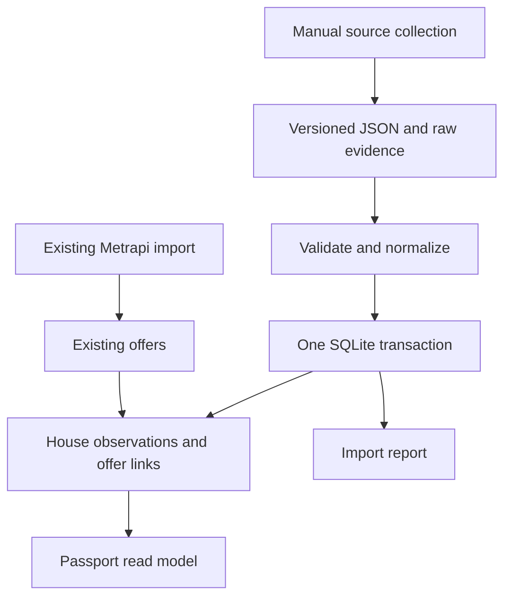

# House-passport ingestion and provenance

Status: **proposed implementation contract, not deployed**. Repository baseline: `Sacraer-group/farposton`, commit `a697ee5d3805af89bb162705dc5cdb4b933f7cef`. This document changes no application code or live database. It uses the six additive tables and repository functions defined in `01-domain-storage.md` and `house_schema.sql`.

## 1. Observed facts and resulting boundary

The inspected application uses Python 3.11+, Flask, SQLite, `requests`, and NumPy. `flats/cli.py` actually exposes `init-db`, `import-json`, `demo`, and `embed`; the `import` command in the older contracts document is not the current implementation. `flats/importer.py:run_import` writes `import_runs` and calls `repo_offers.upsert_offer`. That upsert replaces all non-key offer fields. `repo_offers.last_ok_run` reads the offer-import run log. These paths must remain separate from house ingestion.

The supplied `house_passports.json` is a real collected snapshot: 48 buildings, 50 offer references, 48 exact VL address matches, 44 regional-programme matches, and 3,005 publication-to-house outage relationships. It contains 415 regional-plan observations, 18 short-term-plan observations, and 37 execution-form observations. Of the last group, the source reports 28 as completed and leaves 9 as `---`. There are 15 unavailable house/year checks in the execution forms. These are snapshot counts, not general product assumptions.

Evidence: inspected `flats/{cli,importer,repo_offers,db}.py`, `flats/schema.sql`, `pyproject.toml`, and `docs/{agent-rules,contracts,architecture,constraints}.md`; collected `house_passports.json`, `parts/{management_coverage,outages_validation,repairs_summary}.json` and their raw-source archives. The read-only mirror does not include the existing test directory; test commands below are acceptance requirements, not claimed executions.

**Decision:** add one offline JSON import path into house tables. Keep the Metrapi listing import, `Offer`, `SearchRow`, `group_id`, decisions, costs, and photo/ML paths unchanged. The user's new house-passport requirement supersedes the old document's out-of-scope entry; implementation documentation must record that scope change. It does not authorize unrelated changes to listing ingestion.

## 2. Smallest useful flow



The Flask request path only reads prepared data. Source collection stays in manual collector scripts; it is not a web dependency. There is no scheduler, queue, new service, or network request while rendering a passport. The initial import needs only standard-library JSON, hashing, dates, and SQLite, plus existing repository code.

**Proposed command; not currently available or executed:**

```bash
FLATS_DB=data/flats.db flats import-house-passports /path/to/house_passports.json
```

`db.init_db(conn)` runs before the data transaction. Its existing `executescript` use must not be invoked inside that transaction. The command calls a new `import_house_passports(conn, bundle)` function, never `importer.run_import` or `repo_offers.upsert_offer`.

## 3. Input contract: the existing version 1 export

The actual top-level shape is:

```json
{
  "schema_version": 1,
  "manifest": {},
  "summary": {},
  "houses": [
    {
      "building_key": "B001",
      "city": "Владивосток",
      "address": "переулок Трудовой 13",
      "address_raw_variants": [],
      "offers": [],
      "coordinates_from_listings": [],
      "vl_match": {},
      "management": {},
      "outages": {},
      "repairs": {},
      "map_coordinates": {},
      "quality_flags": [],
      "utility_bill_evidence": {},
      "resident_problem_evidence": {},
      "municipal_projects": {}
    }
  ]
}
```

This is a structural illustration; the nested blocks in the deliverable contain the actual evidence. Do not replace them with the empty objects above.

Validation occurs before writes:

- Require `schema_version == 1`, a house list, unique nonempty `building_key` values, and valid local address identities. Do not hard-code 48 or 50 as application limits.
- Treat `building_key` as a key within this export, not a permanent database house ID. Resolve through the domain module's `(city, street_type, street_name, house_number, corpus, structure)` identity. Preserve letters, fractions, корпус, and строение.
- Validate every nested `building_key` and requested address against its parent. An exact source match must still agree with the complete normalized address. A mismatch is a rejected attachment, not a fuzzy-match fallback.
- Use `summary` as a reconciliation aid, not as authoritative evidence for individual houses. Check declared counts where present and report disagreement.
- Keep unknown values null. A missing block, empty result, negative claim, transport failure, and parser failure remain distinct.
- Read source URLs as evidence strings. The JSON importer never fetches them or opens arbitrary artifact paths. Raw artifact hashes are verified only by the collector or an explicit offline validation step against the supplied archive.

The additive `utility_bill_evidence`, `resident_problem_evidence`, and `municipal_projects` blocks may be retained as snapshot metadata or ignored by the first SQL projection without creating assertions. They do not add tables or implementation tasks in this slice. No bill documents, independently confirmed resident problems, or complete municipal-project history are established by this collection. Empty map claims do not mean residents have no problems; an unavailable municipal source does not mean there are no projects. Do not reinterpret these unsupported blocks as verified negatives.

`offers` supplies `(source, source_id)` references and their address context. Link only offer keys already present in `offers`, after address agreement. Missing offer keys produce an unlinked-reference report; they do not cause listing creation. A changed existing offer address must pass domain matching again. Never silently move an offer to a different house from its export ordinal.

## 4. Translation into the six-table model

Reuse the domain repository functions; ingestion must not implement its own competing address matcher or SQL repository:

```python
ensure_house(conn, address, *, address_display: str, created_at: str) -> int
link_offer_house(conn, source, source_id, house_id, *, match_status,
                 offer_address_raw, match_basis, evidence_url,
                 checked_at, note=None, candidates=None) -> None
store_house_observation(conn, house_id, observation: dict) -> int
```

An observation is a plain dictionary:

```python
{
    "source": {...},   # house_sources fields; no id/house_id/recorded_at
    "facts": None,     # or house_facts fields; no source_id
    "contacts": [],   # house_contacts fields; no id/source_id
    "events": [],     # house_events fields; no id/source_id
}
```

The repository supplies `recorded_at`, returns the source receipt ID, and does not commit. All related rows reference that receipt. An existing receipt is immutable.

| Collected input | Database projection | Evidence retained |
| --- | --- | --- |
| Parent address, VL match | `houses`; identity `house_sources` | Original address, VL house ID, match basis, checked source URL |
| Existing offer references | `offer_houses` | Raw offer address, exact match basis and evidence URL |
| `management.building_fields` | `house_sources` + `house_facts` | Split by source URL and observation time; preserve original labels and values |
| `repairs.building_fields` | Facts on the FKR programme observation | Official programme row, edition date; unmapped fields such as last-repair-year remain in `raw_json` |
| `management.organizations` | `house_contacts` with `scope='house'` | House relationship URL, role, raw phone, verification limitations |
| `management.city_service_contacts` | Contacts with `scope='city_directory'` | Never promoted into a confirmed house service provider |
| `outages.events` | `house_events.kind='outage'` | Source event ID, house-specific duration, original periods and status |
| FKR regional and short-term work rows | `house_events.kind='repair_plan'` | Document family, year/range, sheet/row/column, raw cost |
| FKR execution-form work rows | `house_events.kind='repair_execution'` | Programme year, source house ID, raw completion claim |
| `map_coordinates` | Coordinate observation + facts | Source marker, precision statement and listing-distance checks |
| Source checks and coverage flags | `house_sources` | Fetch outcome, error, source timing, coverage, raw input |

Map field names explicitly: VL `floors` and FKR `floors_total` become `floors_text`; `commissioning_year`/`year_commissioned` become `commissioning_year`; service text remains text. Convert a year or entrance count only when its value is unambiguous. Do not turn free text into zero. Listing coordinates are comparison evidence, and house import never overwrites `offers.lat/lon`.

FKR form 1 totals are metadata of the document observation; form 2 supplies individual work events. Do not create a second event for a form 1 aggregate. Retain whole-building repair amounts in event/raw document JSON; they do not enter `Costs`. There are no supplied utility-bill documents from which to infer a tenant's utility bill.

## 5. Source keys, event keys, and repeatability

`house_sources` is unique on `(house_id, source_key, checked_at)`. A `source_key` names a logical source section and stays stable when its URL, document edition, or data values change. Examples are `vl:info`, `vl:contacts`, `vl:history:page:0`, `vl:history:page:15`, `fkr:regional-programme`, `fkr:short:2026-2028:form2`, and `fkr:execution:2026`. Pagination offsets identify captured pages, never individual events.

When one input block combines several sources, create separate receipts. Preserve the overall history coverage in the root history receipt's `coverage_json`; attach each event to the receipt for its actual `history_page_url`. A changed pagination offset must not change an event's identity.

| Source item | Stable event key rule |
| --- | --- |
| VL outage | `vl:blackout:<source_event_id>` |
| FKR regional work | `fkr:regional:<work-kind fingerprint>` within this house |
| FKR short-term work | `fkr:short:2026-2028:<planned year>:<work-kind fingerprint>` |
| FKR execution work | `fkr:execution:<programme year>:<source_house_id>:<work-kind fingerprint>` |

The work-kind fingerprint is a deterministic hash of the normalized source work label; normalize only case and whitespace. Keep the original label. Do not include cost, status, fetched time, row number, or edition date. Those fields can change in a later observation of the same work. Do not infer equivalence between differently named works or merge a plan with an execution claim. If two distinct rows collide on the chosen key within one receipt, fail that source normalization for review instead of silently dropping a row.

The SQL uniqueness `(source_id, event_key)` permits versioned evidence. The read model deduplicates a logical event by **house, provider, and event key**, retaining its observation history. One VL blackout ID can apply to several houses with different durations. Contact keys similarly use an observed organization/directory identifier plus role and scope where available; otherwise use normalized organization name, role, and scope. A changed phone is a new observation of the same contact, not a new identity.

Replay rules:

1. Same source receipt key and the same normalized payload: return the existing ID; insert no duplicate facts, contacts, or events. A fresh `recorded_at` is not part of payload equality.
2. Same receipt key with different evidence: reject the inconsistent input. Do not update an immutable receipt in place.
3. A genuinely new collection time: append a new receipt even if the body hash is unchanged. The unchanged body is fresh evidence only if it was actually retrieved again.
4. An older bundle imported later stays historical. Read selection follows source collection time, not database insertion time.

## 6. Time, confidence, and conflicts

| Field | Meaning and rule |
| --- | --- |
| `checked_at` | Time recorded for the specific source attempt/check; keep the input value |
| `fetched_at` | Actual remote response retrieval time; nullable when not established |
| `recorded_at` | Database insertion time; never a freshness claim |
| `published_at` | Explicit source publication timestamp, otherwise null |
| `source_as_of` | Source's own claimed data date, if present |
| `document_date` | Explicit edition date; retain whether it came from an index link or the document itself |
| Event period | Original text plus only calendar components actually established by the source |

The current outage collector sets `events[].observed_at` while parsing, including when reading cached HTML. Therefore obtain retrieval time from the matching `source_checks[].fetched_at` for that page where available; preserve the original event timestamp in raw JSON. Do not label the parsing time as a fresh source retrieval. For FKR documents use their recorded retrieval metadata. Do not assign `manifest.consolidated_at_utc` or the import clock to all facts.

For a period such as `с 2 ноя. 19:31 по 3 ноя. 00:00`, retain `period_text`; leave `starts_at`, `ends_at`, and year fields null. Do not supply the current year or infer a year from feed order. A FKR period `2041 - 2043` may populate `year_from=2041`, `year_to=2043`, but it is not an exact timestamp. A source's end label does not independently establish restoration. A FKR execution page year is not an exact completion date.

Set `completion_reported=1` only from an explicit completion claim such as the observed FKR `Работы выполнены...`. Set it to `0` only for an explicit negative claim; `---` becomes null while the raw status is retained. Plans and outages always leave this field null.

Preserve conflicting claims separately. The dataset has three unresolved management-company conflicts and eight FKR/listing floor-count disagreements. `unresolved_conflict` plus a common `conflict_key` attaches both management assertions to the same question. Official FKR building attributes do not verify the current management contract. Source authority and freshness are evidence to display, not permission to erase another claim. The importer does not choose a globally “true” management company, compute a house score, or promote city-directory phone numbers to verified house providers.

## 7. Partial failure and atomic import

Remote collection and database import are separate failure boundaries. Collectors write a new local snapshot and receipts before a database transaction begins. Within one valid snapshot, a failed provider or page must not prevent other successful observations from being imported.

| Input outcome | Stored outcome | Existing evidence |
| --- | --- | --- |
| Successful exact-address response | `ok` receipt with parsed content | Append; old observation remains |
| Explicitly empty successful page | `empty` receipt with exact scope and coverage | Do not infer no real-world events |
| Exact address absent in checked source | `not_found` receipt | Preserve prior successful evidence; show latest absence as a coverage issue |
| Ambiguous or mismatched address | `ambiguous` receipt; no attached facts/events | No guessed merge |
| HTTP 401/403/429 | `blocked` receipt; stop that request path | Keep last successful observation and original freshness |
| Timeout/503 after one bounded retry | `error` receipt | Keep last successful observation |
| HTML/schema changed or parse failed | `parse_error` receipt | Do not turn parser failure into an empty result |

There is no `partial` fetch-status enum in the proposed SQL: partial coverage belongs in `coverage_json`, alongside page failures and the checked period. Keep both latest attempt and last successful observation available to the read model. A missing work row or listing does not prove completion, removal, tenancy, or absence.

For a newer successful complete source section, its current assertions can be shown as that edition, while previous assertions remain historical. Missing values should be labelled missing from the newer edition; do not silently carry them forward as freshly confirmed. Failed or incomplete refreshes never replace a valid snapshot with an empty passport.

After normalization and validation, one `with conn:` transaction stores houses, eligible offer links, and all receipts/children. Repository calls do not commit. An unexpected SQL failure rolls back the entire data import. No writes are made to `offers`, `import_runs`, `decisions`, `search_profile`, or `photo_features`.

Return/print a compact report: bundle version/hash, houses processed, offer links stored or unlinked, receipts added or replayed, event observations, blocked/error source counts, and conflicts requiring review. Exit 0 means a valid bundle was atomically imported, including explicitly recorded source gaps; it does not mean all providers succeeded. Invalid bundle or database failure returns nonzero. No new run-log table is necessary for this slice: source receipts and the CLI report supply the audit trail.

## 8. Subsequent collection: only observed public routes

These are routes observed during this collection, not a guarantee of a stable public API. Follow links/IDs returned by the site; do not manufacture undiscovered endpoints or probe protected routes.

| Source | Observed route and parameters | Refresh procedure |
| --- | --- | --- |
| VL address selection | `https://www.vl.ru/off/addresses/autocomplete?query=<address query>` | Require one full normalized address match; follow the returned slug and read the house ID from its links |
| VL facts and contacts | `/off/b/info/<house_id>`, `/off/b/contacts/<house_id>` | Verify the displayed house address before attaching data |
| VL outage history | `/off/b/story/<house_id>` | Follow the page's `data-url`; observed continuation `/off/building/<house_id>/blackout-history/content?offset=15` |
| VL outage publication | `/off/blackout/<source_event_id>.html` | Keep the observed event link and ID; no assumption that all detail pages were fetched |
| VL map | `/off/map/building/<house_id>?stop-fullscreen-on-mobile=1` | Preserve source marker precision, never claim entrance accuracy |
| FKR programme files | `https://fkr25.ru/` links to `/files/2014-2088/Электронная база данных.xls` and `/files/2026-2028/Форма 1 2026-28.xls`, `Форма 2 2026-28.xls` | Download each linked file once; match the 48 target addresses locally; record the current linked edition and hash |
| FKR yearly forms | `https://fkr25.ru/RepairProgram` links to `/RepairProgram2017` through `/RepairProgram2026` | Read each page's year and linked JavaScript, then use only the paths actually discovered there |

Observed 2026 FKR request parameters are `getstreet?id=г. Владивосток&year=2026`, `gethouse?street=<returned street>&town=г. Владивосток&year=2026`, and `getaddress?id=<returned house id>&year=2026`, under `/RepairProgram2026/`. Encode query strings with the standard library. Do not assume another year's path or IDs are interchangeable. The canonical host that worked was `fkr25.ru`.

The supplied `scripts/management`, `scripts/outages`, `scripts/repairs`, and `scripts/collect_coordinates.py` are **collection utilities**, not application services. They demonstrate the observed parsers and addressing rules. Their paths are relative to the bundle, but they retain saved-cache reuse and the snapshot's historical cutoff; rerunning them unmodified is not a fresh-update mechanism. A repeatable update must accept a new output directory, explicitly define its requested coverage, retain original fetched timestamps for cached responses, and create a new bundle rather than overwrite the last good one. Use a small serial/bounded request schedule, one retry for transient errors, and stop on access-denied/rate-limit responses.

The research environment has `beautifulsoup4` and `xlrd`; the application's inspected `pyproject.toml` does not declare them. If manual collectors are packaged later, their HTML/XLS dependencies belong in a collector-only environment. The JSON importer and Flask app do not need them. Existing supplementary management claims are imported with their provenance; expanding their collection or adding GIS integrations is outside this task.

## 9. Implementation tasks and fixture acceptance

All commands in this section are **proposed future acceptance commands**. None was run against an implementation in this architecture phase. Tests use existing `pytest` conventions and no network. Synthetic failure variants must be labelled as fixtures, not collected facts.

### HP-I1 — Normalize and atomically import the version 1 bundle

**Depends on:** the domain/identity task and additive schema/repository contract in `01-domain-storage.md`.

**Owns:** `flats/house_import.py`, `tests/test_house_import.py`, `tests/fixtures/house_passports_minimal.json`.

**Input:** the real `house_passports.json` structure, a connection with house tables, existing offers. **Output:** house observations/links and a plain import-report dictionary.

Implement `load_house_bundle(path) -> dict` and `import_house_passports(conn, bundle) -> dict`; use the domain repository, with no new dependency or change to the listing importer. A small fixture should include exact and corpus/slash addresses, one yearless outage, an FKR planned work, an explicit completion, a `---` status, a contact conflict, and a blocked receipt.

Acceptance: initial fixture import, exact replay without duplicate evidence, immutable-key collision rejection, rollback on an injected mid-write failure, and blocked refresh preserving prior values/timestamps. Compare contents of all five legacy tables before/after. On a temporary database seeded with the supplied 50 offer keys, the full bundle must create 48 houses and 50 links; retain 3,005 distinct house/outage-ID relationships and 37 FKR execution observations with 28 true/9 null completion flags. The total includes older outage records and must not become a last-year statistic.

Proposed check: `pytest -q tests/test_house_import.py`.

### HP-I2 — Add the explicit offline CLI command

**Depends on:** HP-I1.

**Owns:** `flats/cli.py`, `tests/test_cli_house_import.py`.

**Input:** one bundle path and the existing `FLATS_DB` setting. **Output:** the imported house data and the report on stdout, or a nonzero validation/database error.

Add only `import-house-passports <path>` to the existing parser. Keep `import-json`, `demo`, `embed`, and `init-db` behavior unchanged. Ensure the new branch never falls through to the demo import. No Metrapi key, HTTP request, photo download, or source refresh is required. Unknown schema versions and malformed JSON fail before data writes; a partial-source bundle imports with visible gap counts.

Proposed check: `pytest -q tests/test_cli_house_import.py`.

### HP-I3 — Make manual source refresh reproducible, after the first passport slice

**Depends on:** HP-I1's bundle normalization and the existing collected raw fixtures. This is a collector task, not a prerequisite for loading today's snapshot or displaying passports.

**Owns:** `scripts/refresh_house_sources.py`, `requirements-house-collectors.txt`, `tests/test_house_source_refresh.py`, `tests/fixtures/house_sources/`.

**Input:** an existing version 1 bundle and a new output directory. **Output:** new raw responses, source checks, and a new version 1 bundle. Reuse the narrowly needed logic from the supplied collectors; keep the script outside `flats` and avoid a scraper/plugin framework. Declare `beautifulsoup4` and `xlrd` only in the collector requirements if that existing parsing approach is retained.

Proposed invocation: `python scripts/refresh_house_sources.py /path/to/house_passports.json --output-dir data/house-snapshots/new-run`.

Acceptance: saved HTML/XLS fixtures prove exact address matches and source IDs; fake responses prove one bounded retry for 503, no retry loop or bypass after 403/429, correct pagination stop/coverage flags, original timestamps on cache reuse, and no destruction of the input bundle when one provider fails. A source-format change produces `parse_error`, never a successful zero-count replacement. Tests do not call live services.

Proposed check: `pytest -q tests/test_house_source_refresh.py`.

## 10. Ready-for-development criteria

The first useful release needs the domain schema, HP-I1, HP-I2, and the passport read/UI tasks. It can use the collected snapshot immediately. HP-I3 improves repeatable maintenance without increasing the runtime product surface. A release is not ready if it alters offer imports, writes source errors as empty facts, loses corpus/slash distinctions, guesses years, erases conflicting claims, or updates freshness merely by reopening cached evidence.
