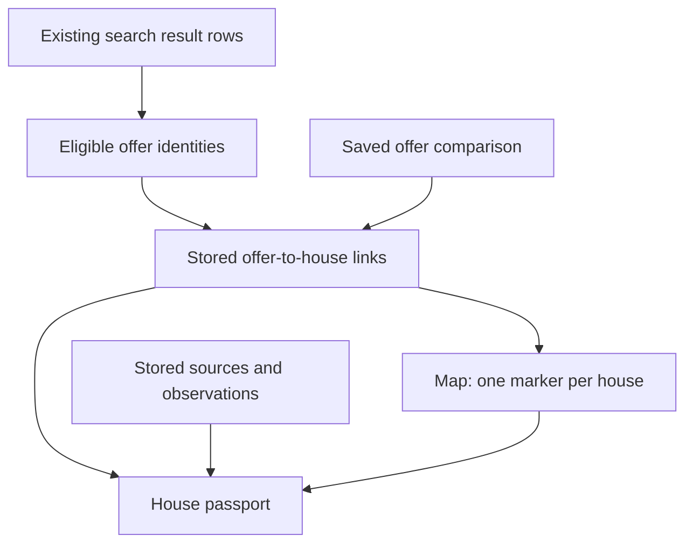

# House passport, map and comparison — implementation specification

Status: proposed next sprint; no application or production changes made. Based on the existing Flask/Jinja application at commit `a697ee5d3805af89bb162705dc5cdb4b933f7cef`, its `docs/{agent-rules,contracts,architecture,constraints}.md`, `flats/search.py`, web routes and templates, and the collected 48-house dataset. The user's revised scope makes the house passport part of choosing a long-term rental.

## 1. Outcome and boundaries

The user can move from a rental offer to its house, see what the available sources actually say about that house, and compare a few apartments without losing their individual costs and conditions. The map is another view of the same eligible apartments. Saved offers, search filters, swipe decisions and visual similarity keep their current behavior.

Extend the server-rendered app with two screens. Keep SQLite, Flask, Jinja and plain JavaScript. No SPA, separate map backend, public house REST API, geocoding request on page load, new account system or house risk score is needed. This layer reads stored observations; a page request never starts collection.



`FlatCard.key` / `group_id` identifies an apartment grouping. It must never become the house identity. A house can contain several apartment cards; an apartment can have several source offers. The selected `SearchRow.offer` remains the source of the displayed costs.

## 2. Routes and screens

| Route | Input and read path | Output |
| --- | --- | --- |
| `GET /house/<int:house_id>` | Local house ID; optional `outage_page`. `get_house_passport`, then existing saved profile + `search` + bulk offer/house lookup for related candidates. | House passport HTML; 404 only for an unknown local house. A known house with no data still has an explanatory page. |
| `GET /house/for-offer/<source>/<source_id>` | Existing offer identity and stored matching result. | Redirect to its passport for `exact`/`manual`; explain `unmatched`/`ambiguous`/`stale` with a return link to the apartment. Unknown offer is 404. Never redirect to a guessed building. |
| `GET /map` | Existing saved search profile, `search(conn, profile)` and bulk offer/house lookup. | Map HTML, embedded marker JSON and an ordinary linked result list. This route does not save the profile or process a second copy of the filter form. |
| Existing `/flat/<path:key>` | Existing `card` and `blocks`, plus an additional offer-keyed house context. | House summary and passport link associated with each offer. |
| Existing `/compare?o=...` | Existing saved-offer selection, order and maximum of five. | Existing cost/condition rows plus concise house rows. |

### Passport layout

1. **Address and house characteristics:** exact corpus/letter/slash; construction and commissioning years distinguished when available; floors, entrances, wall material. Each claim has a source and observation date. A building area is not an apartment area.
2. **Management and services:** house-specific management, maintenance and emergency contacts, with published relationship status. General city emergency numbers appear in a separate subsection. A directory phone is described as published, not tested by a phone call.
3. **Published outages:** resource, original period, reason, organization, source status and source link. Show the requested collection period and coverage explanation. Start with 25 records and provide server-rendered pagination; all retained records remain accessible. Preserve source ordering where dates are incomplete, rather than inventing a chronological order. Planned end is not evidence of actual restoration.
4. **Works:** regional plans and reported execution are separate lists. Preserve programme years and document date. “The source reports completion” is different from independent verification; an empty execution status or `---` remains unknown.
5. **Sources and gaps:** latest successful fetch, latest attempt and source/document date are separately labelled. Show unresolved conflicts and the reason a section lacks data. A short “Questions before viewing” list may be derived from these explicit gaps, e.g. “Which organization currently manages the house?” for a management conflict; it requires no language-model request.
6. **Apartments in this house:** currently eligible `SearchRow` cards with their original offer costs. With zero matching candidates, retain the passport and link to the existing filter screen. Do not silently relax filters.

Use source/date detail disclosure to keep the first screen readable. A passport can be partially filled without being an error page. The shared header's existing “Данные от” timestamp refers to the offer import; house sections must display their own fetch dates.

### Map behavior

Run the existing `search` function once and resolve its selected offer identities in a bulk call. Group only `exact`/`manual` matches by local `house_id`. Each marker counts distinct `row.card.key` values, not source offers. The popup contains address, number of eligible apartments, passport link and those apartments' existing detail links. No new filtering, skip logic or similarity ranking is implemented in JavaScript.

Use house coordinates with their provenance. An offer's approximate coordinate must not silently replace a missing house coordinate. Unmatched offers and houses without usable coordinates remain in an “Address needs checking” list, with links to their apartment cards. Different house matches inside one apartment card remain visible per offer; `card.best` cannot erase that conflict.

The map's ordinary HTML list is fully usable with JavaScript disabled or tiles unavailable. Pin styling may indicate missing/conflicting information but does not imply a good/bad house rating. Do not request the user's location. The position is an address point; entrance-level accuracy has not been established.

### Comparison and existing cards

Keep `blocks = [(offer, costs, questions), ...]` and comparison `columns` unchanged. Add `house_by_offer[(source, source_id)]` as separate template context. Preserve `Offer`, `FlatCard`, `SearchRow`, `questions_for`, `compute_costs`, action forms and saved offer identities.

Add rows for house/address, sourced building characteristics, management status, published outage-history availability and works summary, with a passport link. Long timelines stay in the passport. The comparison does not rank houses by archive event counts: the current archive includes additional older records and yearless dates. House-level information must not fill an offer's unknown utility bill, deposit, commission or monthly payment.

The search card can link through `house_for_offer` without loading every passport. If two selected apartments share a house, both columns remain and show the same passport link; their prices and conditions remain independent.

## 3. Read contract agreed with the domain/storage task

The domain task owns `flats/repo_houses.py` and these additive helpers:

```python
get_house_passport(conn, house_id: int) -> dict | None
house_links_for_offers(
    conn, offer_keys: list[tuple[str, str]]
) -> dict[tuple[str, str], dict]
```

Link values are exactly `{status, house_id, candidates, summary}`. `status` is `exact | manual | unmatched | ambiguous | stale`. An absent relation returns `unmatched`. If an offer's address changes after matching, return `stale` and `house_id=None`; do not expose the old building as certain. `summary` contains `address`, `coordinates`, `management_status`. Coordinates are `{lat, lon, precision, source_url, fetched_at}` or `None`. Management status is `published_claim | conflict_unresolved | not_found_in_checked_sources`.

| Passport key | Contract used by the web layer |
| --- | --- |
| `house` | Local identity and exact display address. Collection keys such as B033 and VL numeric IDs are provenance, not local primary keys. |
| `coordinates` | Address-source coordinate plus precision/source/fetch date, or null. |
| `facts` | Source-specific fixed-field observations; competing values retain their sources. |
| `contacts` | Claims with `scope`, `relationship_status`, `conflict_key` and source association. |
| `outages` | `{events, coverage, published_records_count}`; raw period text survives incomplete normalized dates. |
| `repairs` | `{plans, executions, coverage}`. |
| `sources` | `{latest_attempts, last_successful}`; a failed new attempt does not replace the last usable observation. |
| `issues` | List of `{code, message, source_urls}` for visible limitations and conflicts. |

The web layer derives display labels and marker payloads from this contract; it does not read `parts/*.json` at request time or query source pages. Existing repository functions continue to own offers and decisions.

### Proposed map read-model example

This is the rendered marker payload for **B033, Окатовая 14**, if the current profile includes both apartments and neither is skipped. The coordinates and offer identities are from the collected data. `101` is an illustrative local DB ID, not an inference from B033 or VL's ID 9063.

```json
{
  "markers": [
    {
      "house_id": 101,
      "address": "Владивосток, улица Окатовая 14",
      "lat": 43.098208755432175,
      "lon": 131.91917476292443,
      "passport_url": "/house/101",
      "flat_count": 2,
      "management_status": "published_claim",
      "flats": [
        {
          "key": "5ccbf5bd8fc92bc6e3541477",
          "source": "farpost",
          "source_id": "119489766",
          "url": "/flat/5ccbf5bd8fc92bc6e3541477"
        },
        {
          "key": "6fd67f6940c03b01fd5b8c5a",
          "source": "farpost",
          "source_id": "123591340",
          "url": "/flat/6fd67f6940c03b01fd5b8c5a"
        }
      ]
    }
  ],
  "unmapped": []
}
```

Serialize with Jinja `tojson` inside an `application/json` script element. Build Leaflet popup content with DOM elements and `textContent`; do not interpolate listing text into HTML. External source URLs accept only HTTP/HTTPS. Continue escaping all external text in Jinja; no `|safe` for imported content.

## 4. Information states and wording

| State | Display and behavior |
| --- | --- |
| Partial | Show available sections and specific missing sections. Do not convert missing values to zero or “нет”. |
| Not found in checked sources | “УК не найдена в проверенных источниках” for that section; retain source checks and date. Do not assert that the house has no management organization. |
| Conflict | “Источники называют разные УК”; show both names, their sources and source dates. Do not choose the latest fetch as the current contract holder. |
| Published empty history | “В доступной истории VL.ru записей не найдено”, with collection date and coverage. This does not establish that no outages occurred. |
| Source error with prior data | Keep the previous data; show its actual fetched date and the new failed attempt separately. A cached reparse does not make the source fresher. |
| Address unmatched/ambiguous/stale | Explain why the passport cannot be attached; no nearest-house substitution or misleading map pin. |

For this dataset the requested source-history interval is **2025-11-14 through 2026-11-14, Asia/Vladivostok**. Collection reached the date boundary or source history end for all 48 houses. The **3,005 house/event relations are not a 12-month outage count**: additional older records were retained, and some dates omit the year. `requested_period_complete` means the collection procedure completed for the source, not that the source records every real-world incident. Do not infer years, frequency, reliability scores, restoration times or “no problems”.

## 5. Map dependency decision

Use vendored **Leaflet 1.9.4 stable**, loaded only on `/map`, with its license. No npm/build tool or clustering plugin is needed for 48 houses. The official versioned API reference currently identifies 1.9.4 as stable; its default documentation also offers 2.0.0-beta.4, so pin the version and use matching `L.map` APIs.

For the local study prototype, use browser requests to `https://tile.openstreetmap.org/{z}/{x}/{y}.png`, visible “© OpenStreetMap contributors” attribution linked to the copyright page, and normal browser caching/Referer behavior. Do not apply the existing photo-only `referrerpolicy="no-referrer"` to tile requests. No bulk download, offline tile pack, prefetch or proxy is needed. Keep the tile URL/attribution as app configuration values so they can change together. Tile service is an external, best-effort dependency; render the address list even on tile errors.

Primary documentation checked on 2026-11-14 (Vladivostok):

- [Leaflet 1.9.4 API reference](https://leafletjs.com/reference-1.9.4.html): pinned stable version, map/layer APIs, attribution controls.
- [OpenStreetMap tile policy](https://operations.osmfoundation.org/policies/tiles/): exact HTTPS URL, visible attribution, caching, Referer, no bulk download, availability limitations.
- [OpenStreetMap copyright](https://www.openstreetmap.org/copyright): attribution link target.

## 6. Three implementation tasks with non-overlapping ownership

All tasks depend on the additive domain migration and agreed repository helpers. The integration owner records the new scope/contracts/dependency in the repository docs in a dedicated contract update, as required by existing agent rules. This specification itself does not alter those files.

| Task | Exact proposed ownership | Delivered behavior and dependencies |
| --- | --- | --- |
| **WEB-1: Passport and integration hooks** | `flats/web/houses.py`; `flats/templates/house.html`; `flats/templates/house_unresolved.html`; `flats/templates/_house_summary.html`; `flats/static/houses.css`; `flats/web/__init__.py`; `flats/templates/base.html`; `tests/test_house_pages.py` | Passport/resolver routes, scoped CSS, reusable summary, map navigation, page-level stylesheet block, blueprint registration for both `houses` and `house_map`. Owns the small map configuration defaults in the existing app factory. Depends on domain helpers. |
| **WEB-2: Map view** | `flats/web/house_map.py`; `flats/templates/house_map.html`; `flats/static/house_map.js`; `flats/static/house_map.css`; `flats/static/vendor/leaflet-1.9.4/` (official JS/CSS, referenced image assets, LICENSE); `tests/test_house_map.py` | `/map`, shared-search projection, one marker per house, unmapped and ordinary HTML lists, safe popup DOM, attribution and tile-failure behavior. Depends on domain helpers and WEB-1's registration/style hooks; does not edit the app factory or base template. |
| **WEB-3: Apartment and comparison integration** | `flats/web/pages.py`; `flats/web/compare.py`; `flats/templates/flat.html`; `flats/templates/compare.html`; `flats/templates/_card.html`; `tests/test_house_integration.py` | Offer-aware passport links/summary and comparison rows. Depends on domain helpers and WEB-1's shared summary/resolver. Preserves existing tuple and type contracts. Does not change search, costs, actions, swipe or ML modules. |

WEB-1 supplies `_house_summary.html` with an explicit `house_link` input. WEB-3 consumes it without editing it. WEB-2 supplies its own map styles. Shared template or app-factory changes route back to WEB-1 to avoid parallel edits. A separate docs/integration owner, rather than all three agents, owns `docs/contracts.md`, `docs/architecture.md` and `docs/constraints.md` updates.

## 7. Acceptance evidence and checks

Use small local fixture subsets derived from `addresses.json` and `parts/{management,outages,repairs,coordinates}.json`. Network-free Flask tests should exercise the meaningful identity, state and regression cases; do not create tests that merely mirror HTML structure.

| Case | Acceptance result |
| --- | --- |
| **B027 / B029 / B042**: Майора Филипова 10 кор.1 / 11 кор.1; Тополевая 30 | Passport and comparison visibly retain both АО «Технология управления» and ООО УК «ТЕХНОЛОГИЯ КОМФОРТА» claims, with conflict status and source links. B029's reported contract-start date does not automatically resolve the conflict. |
| **B006 / B023**: Авроровская 6 кор.1; Лесная 153В кор.3 | Management displays unknown-in-checked-sources, while other available sections render normally. City directory contacts never become their claimed management company. |
| **B030**: Маковского 55 кор.2 | Zero published events and exhausted source history render the published-empty-history wording, not “no outages”. The house still has a passport and marker if eligible. |
| **B033**: Окатовая 14 | Offers `farpost:119489766` and `farpost:123591340` have different `group_id` values but one house/marker when both are eligible; two apartment links and independent costs remain. |
| **B034**: Окатовая 18 | Offers `farpost:130837920` and `farpost:138974454` likewise yield one marker and two apartments. Comparing them keeps both columns, including distinct prices/deposits/commissions. |
| **Address distinction** | Ульяновская 12/1 does not become 12 кор.1; corpus/letters survive in URLs' target identity and display. A changed offer address produces `stale`, with no old-house pin. |
| **Coverage and dates** | Older archive entries and yearless periods render as supplied. No computed 12-month count, made-up year or actual restoration claim appears. A failed refresh preserves old data and its old fetch date. |
| **Existing user flows** | A saved profile and skip decision produce the same eligible card keys in search and the map's grouped/unmapped lists. Saving/swiping/undo/visual selection and maximum-five saved-offer comparison keep their existing behavior. |
| **Safety and degradation** | Imported HTML-like text is escaped in page and popup. With JavaScript disabled, tile failure or missing coordinates, users can still reach apartment details/passports from the HTML list. |

Finish with a focused local browser check of map interaction, attribution and narrow-screen comparison, plus the existing offline test suite. No deployment, production writes, remote collection or messages to services are part of these tasks.
